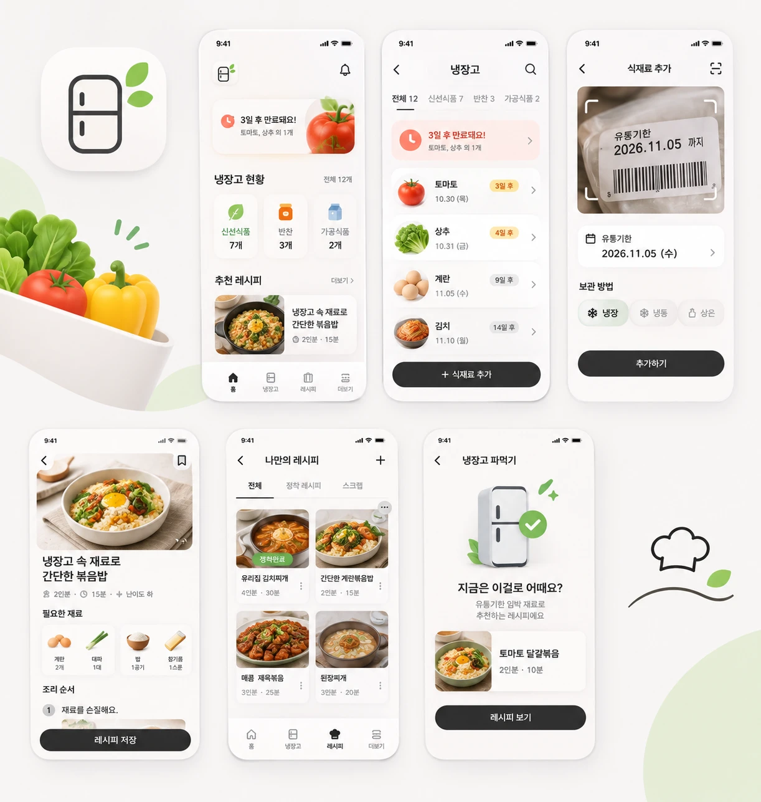

# 주부1단

> 주부 9단 되기 프로젝트

우리 집 식재료와 반찬의 관리 날짜를 놓치지 않고, 가족 레시피를 우리 집 입맛에 맞게 정착시키며, 보유 재료로 오늘의 메뉴를 찾는 개인 주방 관리 앱입니다. 로그인과 서버 없이 기기 안에서 동작합니다.

**현재 상태: MVP 코드 구성 단계이며 실제 iOS·Android 기기에서는 아직 실행하지 못했습니다.** 자동 테스트와 웹 미리보기까지 확인했습니다.



## 핵심 흐름

식재료 등록 → 날짜 확인 → 소비 알림 → 보유 재료로 레시피 찾기 → 우리 집 레시피로 정착

## 기능별 상태

| 기능 | 코드 | 자동 테스트 | 웹 미리보기 | 실기기 |
| --- | --- | --- | --- | --- |
| 식재료 직접 등록·수정·소진·폐기·복구 | O | O | O | 미검증 |
| 냉장·냉동·상온, 검색·필터·정렬 | O | O | 일부 | 미검증 |
| 엄마표 반찬 | O | O | 미확인 | 미검증 |
| 표시 날짜·개인 알림 분리, 상태 안내 | O | O | O | 미검증 |
| 라벨 OCR 후보 파서 | O | O | 해당 없음 | 미검증 |
| OCR 확인 화면 | O | 정책만 | 미확인 | 미검증 |
| iOS Vision 모듈 | O (구문 검사만) | X | 해당 없음 | 미검증 |
| Android OCR | X | X | 해당 없음 | 미구현 |
| 로컬 알림 | O | 계획·재조정 로직 | 해당 없음 | 미검증 |
| 레시피 등록·복제·삭제, 인원수 조절 | O | O | 일부 | 미검증 |
| 단계 메모, 정착, 변경 이력 | O | O | 일부 | 미검증 |
| 링크 저장 | O | O | 미확인 | 미검증 |
| 냉장고 파먹기 | O | O | O | 미검증 |
| 내보내기·복원·전체 삭제 | O | 서비스 로직 | 화면만 | 미검증 |
| 공유 메뉴로 링크 받기 | X | X | X | 미구현 |

## 실행

Node 22.5 이상이 필요합니다.

```bash
npm install
```

```bash
npm test
```

```bash
npm run web
```

웹은 UI 확인용입니다. OCR, 알림, 파일 저장은 동작하지 않습니다.

### iOS

macOS와 Xcode가 필요합니다. 네이티브 OCR 모듈이 있어 Expo Go로는 OCR을 쓸 수 없고 개발 빌드가 필요합니다.

```bash
sudo xcodebuild -license accept
```

```bash
npm run ios
```

### Android

JDK 17과 Android SDK가 필요합니다. OCR 없이 직접 입력으로 동작합니다.

```bash
npm run android
```

## 구조

```text
app/                  Expo Router 화면
src/domain            타입, 날짜, 정책 값
src/features          재고, 식품 안전, OCR, 알림, 레시피, 매칭, 백업, 예시 데이터
src/infrastructure    SQLite, 파일, 알림 어댑터
src/design-system     토큰, 컴포넌트, 아이콘
modules/food-label-ocr  Apple Vision Swift 모듈
plugins/              표시 이름 config plugin
scripts/              이미지 추출, 식품 문구 검사, 라이선스 감사
tests/                단위, 통합 테스트
docs/                 설계, 정책, QA 문서
```

자세한 내용은 [아키텍처](docs/ARCHITECTURE.md)와 [결정 기록](docs/DECISIONS.md)을 참고하세요.

## 식품 안전 날짜 정책

- 앱은 식품 안전을 판정하지 않습니다.
- 소비기한, 유통기한, 품질유지기한, 제조일, 구입일, 개인 관리 알림을 구분해 저장합니다.
- `구입일 + N일` 같은 자동 기한 계산이 없습니다.
- OCR 날짜는 후보이며 사용자가 날짜와 종류를 확인해야 저장됩니다.
- 표시 날짜가 지난 재료는 추천 근거에서 뺍니다.

자세히: [식품 안전 정책](docs/FOOD_SAFETY_POLICY.md)

## 외부 레시피 정책

URL과 직접 쓴 제목·메모만 저장합니다. 외부 본문, 사진, 영상, 자막을 가져오지 않습니다. [저작권 정책](docs/RECIPE_COPYRIGHT_POLICY.md)

## 데이터와 개인정보

모든 데이터는 기기의 SQLite와 앱 전용 폴더에 저장됩니다. 라벨 사진과 OCR 원문은 기본 보관하지 않습니다. 내보내기, 복원, 전체 삭제를 제공합니다. [개인정보](docs/PRIVACY.md)

## 라이선스와 비용

- 런타임 직접 의존성은 모두 MIT입니다. [라이선스](docs/MODEL_AND_LIBRARY_LICENSES.md)
- 앱 운영에 서버 비용은 없지만 스토어 배포 비용은 별도입니다(Apple 연 US$99, Google 1회 US$25). [비용](docs/COSTS_AND_DISTRIBUTION.md)
- **예시 이미지는 UX 보드에서 추출했으며 상업적 사용 권리 확인이 출시 전에 필요합니다.**

## 다음 작업

실기기 테스트는 나중에 진행하기로 했습니다. 재개할 때 아래 순서로 준비합니다.

1. 터미널에서 `sudo xcodebuild -license accept`를 실행합니다(Mac 로그인 비밀번호 필요).
2. CocoaPods를 설치합니다(현재 이 개발 Mac에 없음).
3. Xcode에 Apple 계정을 추가합니다. 현재 코드 서명 인증서가 없습니다. 무료 Apple ID로 설치한 앱은 7일 뒤 만료됩니다.
4. iPhone을 연결해 이 컴퓨터를 신뢰하고 개발자 모드를 켭니다.
5. `npm run ios`로 Swift 모듈을 컴파일해 실행하고, 한국어 라벨 OCR과 알림을 확인해 `docs/OCR_BENCHMARKS.md`, `docs/TESTING.md`에 기록합니다.
6. [로드맵](docs/ROADMAP.md)의 남은 항목을 진행합니다.

Xcode 없이 설치하려면 유료 Apple Developer 계정과 EAS 클라우드 빌드가 필요합니다. iPhone은 서명 없는 설치 파일을 옮겨서 설치할 수 없습니다. Android APK는 파일로 옮겨 설치할 수 있지만 OCR 없이 직접 입력으로 동작합니다.

## 작업 내역 (Work Log)

### 2026-11-03: 프로젝트 구성과 MVP 구현

**구현**

- Expo SDK 58, Router, SQLite 기반 프로젝트와 슈퍼프롬프트 §10 구조 구성
- UX 보드 7개 화면 재현, 나머지 화면(온보딩, OCR 확인, 식재료 상세, 레시피 편집, 링크 저장, 설정, 데이터 관리, 안내)을 같은 스타일로 구현
- 보드 이미지 추출 스크립트, 앱 아이콘과 라인 아이콘 벡터 재작성
- 식품 날짜 정책, 상태 계산, OCR 날짜 파서, 재고, 알림 재조정, 레시피, 매칭, 백업, 예시 데이터
- Apple Vision Swift 모듈(컴파일 미검증)
- `docs/` 문서 17종

**아키텍처 결정** (전체는 `docs/DECISIONS.md`)

- 프롬프트 구조의 위치 중복 제거, 저장소 루트를 앱 루트로 사용
- 웹 미리보기로 드러나지 않던 prebuild 실패 수정: `expo.name` 영문화와 표시 이름 plugin
- 보드와 프롬프트 충돌 시 레이아웃은 보드, 안전 문구는 프롬프트 우선 (`만료돼요` → `표시 날짜예요`)

**실행한 명령과 결과**

| 명령 | 결과 |
| --- | --- |
| `npx jest` | 8개 파일, 94개 통과 |
| `npx tsc --noEmit` | 통과 |
| `npx expo lint` | 통과 |
| `npx expo-doctor` | 20개 통과 |
| `npx expo prebuild --no-install` | iOS·Android 통과 |
| `npx expo export --platform ios --platform android` | 통과 |
| `swiftc -parse` | 통과 (구문만) |
| `npm run verify:food-guidance` | 통과 |
| `npm run audit:licenses` | 런타임 직접 의존성 MIT |
| 웹 미리보기 수동 확인 | 온보딩, 등록, 소진, 재시작 유지, 복구 통과 |

**미실행·미검증**

- iOS 시뮬레이터·실기기: 미실행. 이 Mac의 Xcode 라이선스 동의가 필요해 `xcodebuild`, `simctl`을 쓸 수 없었음
- Android 에뮬레이터·실기기: 미실행
- OCR 처리 이미지 0장, 정확도 측정 없음
- 실제 알림, 카메라, 사진 선택기, 내보내기·복원 UI
- Dynamic Type, VoiceOver, Reduce Motion

**라이선스·비용 검토**: 2026-11-03. 미해결: 보드 이미지 권리, 앱 내 라이선스 전문 화면.

### 2026-11-03: GitHub 첫 푸시와 iPhone 설치 준비 점검

**진행**

- 첫 커밋을 GitHub `main`에 푸시하고 원격과 로컬의 커밋이 같은 것을 확인
- 이 저장소의 원격 주소가 저장소 소유자 계정을 쓰도록 지정 (전역 git 인증은 변경하지 않음)
- 연결된 iPhone 설치 가능 여부 점검, 재개 절차를 `다음 작업`에 정리

**점검 결과**

| 항목 | 결과 |
| --- | --- |
| Xcode 라이선스 | 미동의. `xcodebuild`, `simctl`, `devicectl` 사용 불가 |
| 연결된 iPhone | 조회 불가 |
| 코드 서명 인증서 | 0개 |
| CocoaPods | 미설치 |

**결정**: 실기기 테스트는 사용자 판단으로 나중에 진행한다.

**미실행·미검증**: 앱 코드는 변경하지 않았고 이번 작업에서 테스트를 다시 실행하지 않았다. iOS·Android 빌드와 기기 실행, OCR은 여전히 미검증이다.
